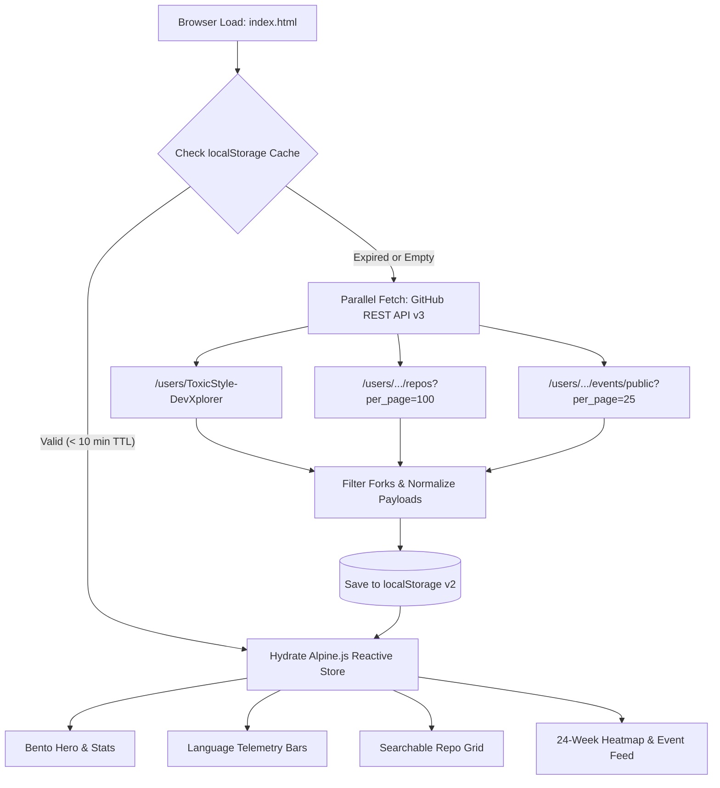

<div align="center">

  <h1>🌿 ToxicStyle-DevXplorer — Aurora Portfolio</h1>

  <p>
    <strong>A zero-build, reactive developer portfolio & live GitHub telemetry dashboard engineered with Light & Dark Mint Aurora aesthetics.</strong>
  </p>

  <p>
    <a href="https://toxicstyle-devxplorer.github.io" target="_blank">
      
    </a>
    <a href="https://github.com/ToxicStyle-DevXplorer/ToxicStyle-DevXplorer.github.io/blob/main/LICENSE">
      
    </a>
    
  </p>

  <p>
    
    
    
    
  </p>

  <p>
    <a href="#-key-features">Features</a> •
    <a href="#-system-architecture">Architecture</a> •
    <a href="#-tech-stack">Tech Stack</a> •
    <a href="#-quick-start">Quick Start</a> •
    <a href="#-configuration">Configuration</a> •
    <a href="#-roadmap">Roadmap</a>
  </p>

</div>

---

## ◈ Overview

**ToxicStyle-DevXplorer.github.io** is a single-page, client-side engineering portfolio designed around a **Bento Grid** layout and **Glassmorphism** surfaces. Rather than relying on static hardcoded project lists, the application synchronizes directly with the **GitHub REST API** to compute language distributions, render a 24-week activity heatmap, stream recent public repository events, and provide instant client-side filtering.

Built without heavy build pipelines (`npm`/`webpack`/`vite`), the entire application runs natively in the browser with sub-second load times and instant deployment to **GitHub Pages**.

---

## ◈ Key Features

### 1. Dual-Theme Aurora Engine (Light & Dark Mode)
* **Ambient Animated Mesh:** Multi-layered, GPU-accelerated CSS keyframe aurora blobs paired with a subtle engineering coordinate grid and an interactive cursor-tracking radial glow.
* **Circular Wave Theme Transition:** Utilizes the native **View Transitions API** (`document.startViewTransition`) to expand a smooth circular `clip-path` ripple directly from the pointer's `(x, y)` coordinates when toggling between **Light Mint Aurora** and **Dark Emerald Aurora**.
* **Persistent State:** Automatically saves and restores the user's preferred theme via `localStorage`.

### 2. Live GitHub Telemetry & Analytics
* **Real-Time Profile & Metrics:** Fetches avatar, bio, location, follower count, public repository count, and cumulative star count.
* **Codebase Language Distribution:** Dynamically aggregates programming languages across all non-forked repositories, calculating percentage shares with interactive progress bars that filter the repository explorer on click.
* **24-Week Aurora Contribution Matrix:** Maps recent push timestamps, repository creation dates, and public events onto a 168-day interactive heatmap.
* **Live Event Stream:** Displays the latest `PushEvent`, `CreateEvent`, `PullRequestEvent`, `ReleaseEvent`, and `WatchEvent` actions with relative timestamps (`just now`, `2h ago`, `3d ago`).

### 3. Interactive Developer Workspace & IDE Widget
* **Multi-Tab Code Window:** Switch seamlessly between `developer.ts` (TypeScript engineer profile), `stack.json` (system telemetry), and `neofetch.sh` (Arch Linux + Hyprland environment specs).
* **Keyboard-First Repository Explorer:** Press `/` anywhere on the page to immediately focus the search bar, filter repositories by name, description, or language, and sort by **Recently Updated** or **Most Stars**.
* **Workstation & Hardware Showcase:** Dedicated Bento cards highlighting the **Arch Linux + Hyprland** Wayland workflow and custom **42-key Corne wireless split keyboard** (`ZMK` firmware / `nRF52840` / `ESP32-S3`).

### 4. Mobile-First Responsive Design
* Fully adaptive layouts scaling from `360px` mobile viewports up to ultrawide desktop displays, complete with a collapsible mobile navigation drawer and touch-friendly controls.

---

## ◈ System Architecture

The application follows a reactive, zero-build data pipeline with local caching to stay well within GitHub's unauthenticated REST API rate limits (`60 requests/hour` per IP).



---

## ◈ Tech Stack

| Layer | Technology | Role & Implementation Details |
| :--- | :--- | :--- |
| **Markup** | `HTML5` | Semantic structure, accessible ARIA attributes, OpenGraph-ready metadata. |
| **Styling** | `Tailwind CSS (CDN)` | Utility-first responsive grid, `class`-based dark mode, custom keyframe animations. |
| **Custom CSS** | `CSS3 Variables & Backdrop Filter` | Frosted glass surfaces (`backdrop-filter: blur(20px)`), custom scrollbars, View Transition overrides. |
| **Reactivity** | `Alpine.js v3` | Declarative state management (`x-data`, `x-for`, `x-model`, `$watch`), computed getters, keyboard shortcuts. |
| **Icons** | `Lucide Icons` | Crisp vector iconography dynamically re-rendered on reactive DOM updates. |
| **Data Source** | `GitHub REST API v3` | Asynchronous `Promise.all` synchronization for user profile, repositories, and public activity events. |
| **Typography** | `Plus Jakarta Sans` & `JetBrains Mono` | Geometric sans-serif headings paired with developer-grade monospace telemetry and code blocks. |

---

## ◈ Project Structure

```text
ToxicStyle-DevXplorer.github.io/
├── index.html      # Main semantic layout, Bento sections, IDE tabs, and Alpine directives
├── style.css       # Aurora glassmorphism utilities, dark theme overrides, and View Transition animations
├── script.js       # Reactive state controller, GitHub API client, TTL caching, and heatmap engine
├── LICENSE         # MIT License
└── README.md       # Project documentation
```

---

## ◈ Quick Start

### Local Preview
Because the project has zero build dependencies, you can run it locally using any static file server:

```bash
# 1. Clone the repository
git clone https://github.com/ToxicStyle-DevXplorer/ToxicStyle-DevXplorer.github.io.git
cd ToxicStyle-DevXplorer.github.io

# 2. Serve locally (choose any one method)
python3 -m http.server 8080
# OR using Node.js:
npx serve .
```

Open `http://localhost:8080` in your browser to inspect the live application.

### Deploying Updates to GitHub Pages

```bash
git add .
git commit -m "chore: update portfolio content"
git push origin main
```

GitHub Pages automatically rebuilds and serves the updated site within **30–60 seconds**.

---

## ◈ Configuration

All core data parameters are centralized at the top of `script.js` inside `githubPortfolio()`:

```javascript
const USERNAME = 'ToxicStyle-DevXplorer';          // Target GitHub handle
const CACHE_KEY = `gh_portfolio_${USERNAME}_v2`;   // localStorage cache namespace
const CACHE_TTL = 10 * 60 * 1000;                  // Cache lifetime in ms (default: 10 mins)
```

* **Forcing a Cache Refresh:** Open browser DevTools (`F12`) → **Application** → **Local Storage** → delete `gh_portfolio_ToxicStyle-DevXplorer_v2` and reload the page.
* **Customizing Contact Links:** Update the Telegram URL or handle copy action inside the `#contact` section of `index.html`.

---

## ◈ Roadmap

- [x] Light & Dark Mint Aurora glassmorphism theme engine
- [x] Circular ripple theme transition via View Transitions API
- [x] Live GitHub REST API synchronization with `localStorage` TTL caching
- [x] Dynamic language distribution telemetry & 24-week contribution heatmap
- [x] Mobile-responsive navigation drawer and adaptive hardware matrix
- [ ] **In-App `README.md` Inspector Modal:** Preview repository documentation without leaving the page
- [ ] **Command Palette (`Ctrl + K`):** Keyboard-driven quick actions and repository jump menu
- [ ] **Interactive Mini-Terminal:** Executable shell commands (`help`, `whoami`, `neofetch`, `repos`) inside the IDE widget

---

## ◈ Author & License

**ToxicStyle-DevXplorer** — *Systems Programmer, Full-Stack Builder & Hardware Enthusiast*

* **GitHub:** [@ToxicStyle-DevXplorer](https://github.com/ToxicStyle-DevXplorer)
* **Portfolio:** [toxicstyle-devxplorer.github.io](https://toxicstyle-devxplorer.github.io)
* **Telegram:** [@ToxicStyle_DevXplorer](https://t.me/ToxicStyle_DevXplorer)

Distributed under the **MIT License**. See `LICENSE` for more information.
